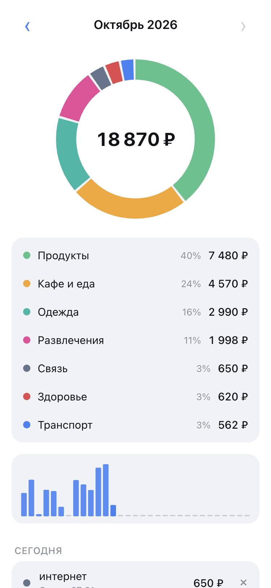

# spendlog

[](https://github.com/qweendev/spendlog/actions/workflows/ci.yml)


An expense tracker that lives in Telegram. You type what you spent, like «250 taxi», and the bot files it
under the right category. A Mini App shows where the money went this month.

<p align="center"></p>

## Why I built it

A lot of people learned to write Telegram bots from Alexey Goloburdin's
[telegram-finance-bot](https://github.com/alexey-goloburdin/telegram-finance-bot), me included. The idea is
great: writing an expense into a chat is faster than opening any budgeting app. But it was a teaching project,
it hasn't been touched in years, it only answers in text, and it has no license, so nobody can legally build
on it.

So I wrote my own from scratch, with the parts I was missing: a real interface for looking at the month,
correct days for people outside UTC, and code I'd be fine maintaining for years.

## What it does

Send a message that starts or ends with an amount: «250 такси», «кофе 180,50», «3.5 coffee». The bot
guesses the category from the words, so «продукты в пятёрочке» goes to groceries and «аптека» to health. If
it guesses wrong, there's a button to pick another category, and another one to undo.

/today and /month answer right in the chat. /undo removes the last entry and /currency EUR switches the
currency for new entries.

The Mini App opens from the bot's menu button. It shows the month total, a breakdown by category, spending
by day and the full history where you can delete anything. It picks up the colors of your Telegram theme
and has arrows to flip between months.

Every request from the Mini App is checked against the signature Telegram puts into it, so nobody can read
or change someone else's expenses by guessing an id. Days are counted in your own timezone, which the Mini
App reports the first time you open it.

## Running it

Create a bot with [@BotFather](https://t.me/BotFather) and copy the token. Then:

```
cp .env.example .env
docker compose up -d
```

Put the token into `.env` before starting. The bot works right away. For the Mini App, the app has to be
reachable over HTTPS: put it behind any reverse proxy or a tunnel, set `SPENDLOG_WEBAPP_URL` to that address
and restart. The bot then adds the app to its menu button by itself.

Without Docker:

```
uv sync
uv run spendlog
```

| variable | default | what it does |
|---|---|---|
| `SPENDLOG_BOT_TOKEN` | | token from BotFather, required |
| `SPENDLOG_WEBAPP_URL` | | public HTTPS address of the app, turns on the Mini App |
| `SPENDLOG_DATABASE_URL` | `sqlite+aiosqlite:///data/spendlog.db` | any async SQLAlchemy URL |
| `SPENDLOG_DEFAULT_TIMEZONE` | `Europe/Moscow` | used until the Mini App reports the real one |
| `SPENDLOG_PORT` | `8080` | port for the Mini App and its API |

## Development

```
uv sync
uv run pytest
uv run ruff check .
uv run mypy src tests
```

The Mini App is plain HTML, CSS and JavaScript in `src/spendlog/webapp`, no build step.

## License

MIT, see [LICENSE](LICENSE).
