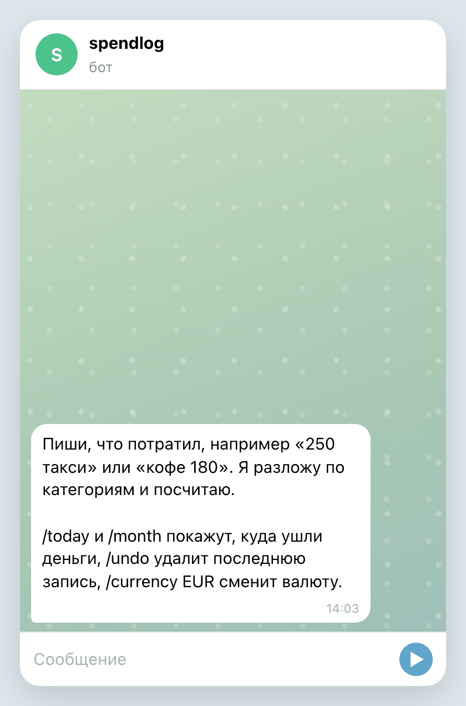

# spendlog

[](https://github.com/qweendev/spendlog/actions/workflows/ci.yml)


Учёт расходов прямо в Telegram. Пишете боту «250 такси», он сам относит трату к нужной категории,
а в мини-приложении видно, куда ушли деньги за месяц.

<p align="center">
  
  
</p>

## Как пользоваться

Отправьте сообщение, которое начинается или заканчивается суммой: «250 такси», «кофе 180,50», «обед 450».
Категорию бот определяет по словам, поэтому «продукты в пятёрочке» попадут в продукты, а «аптека» в здоровье.
Если он ошибся, под записью есть кнопка для выбора другой категории и кнопка отмены.

Команды:

- `/today` траты за сегодня
- `/month` траты за месяц по категориям
- `/undo` удалить последнюю запись
- `/currency EUR` сменить валюту для новых записей

Мини-приложение открывается из кнопки меню бота. В нём итог за месяц, разбивка по категориям, траты по дням
и вся история, из которой можно удалить любую запись. Цвета подстраиваются под тему Telegram.

Каждый запрос из мини-приложения проверяется по подписи Telegram, поэтому чужие траты не посмотреть и не удалить.
Дни считаются по вашему часовому поясу, приложение сообщает его при первом открытии.

## Запуск

Создайте бота через [@BotFather](https://t.me/BotFather) и скопируйте токен. Потом:

```
cp .env.example .env
docker compose up -d
```

Перед запуском вставьте токен в `.env`. Бот заработает сразу. Мини-приложению нужен адрес с HTTPS:
поставьте приложение за обратный прокси или туннель, укажите этот адрес в `SPENDLOG_WEBAPP_URL` и перезапустите.
Бот сам добавит приложение в кнопку меню.

Без Docker:

```
uv sync
uv run spendlog
```

| переменная | по умолчанию | что делает |
|---|---|---|
| `SPENDLOG_BOT_TOKEN` | | токен от BotFather, обязательно |
| `SPENDLOG_WEBAPP_URL` | | адрес приложения с HTTPS, включает мини-приложение |
| `SPENDLOG_DATABASE_URL` | `sqlite+aiosqlite:///data/spendlog.db` | любой асинхронный адрес SQLAlchemy |
| `SPENDLOG_DEFAULT_TIMEZONE` | `Europe/Moscow` | часовой пояс до первого открытия мини-приложения |
| `SPENDLOG_PORT` | `8080` | порт мини-приложения и его API |

## Разработка

```
uv sync
uv run pytest
uv run ruff check .
uv run mypy src tests
```

Мини-приложение написано на обычных HTML, CSS и JavaScript в `src/spendlog/webapp`, сборка не нужна.

## Лицензия

MIT, текст в файле [LICENSE](LICENSE).
